<div align="center">

```
  ___  ____      _      ____  ____      _    ____   ___
 / _ \|  _ \    / \    | __ )|  _ \    / \  | __ ) / _ \
| | | | |_) |  / _ \   |  _ \| |_) |  / _ \ |  _ \| | | |
| |_| |  _ <  / ___ \  | |_) |  _ <  / ___ \| |_) | |_| |
 \___/|_| \_\/_/   \_\ |____/|_| \_\/_/   \_\____/ \___/
                    S T U D I O
```

### O estúdio Oracle do DBA, no terminal.
**Worksheet SQL · navegador de objetos · aba DBA com 97 telas — num binário de 22 MB, sem Java, sem Instant Client.**

[](https://go.dev)
[](https://www.oracle.com/database/)
[](#instalar)
[](LICENSE)
[](#status)
[](https://github.com/acaciolr)

**[Português](#português)** · **[English](#english)**

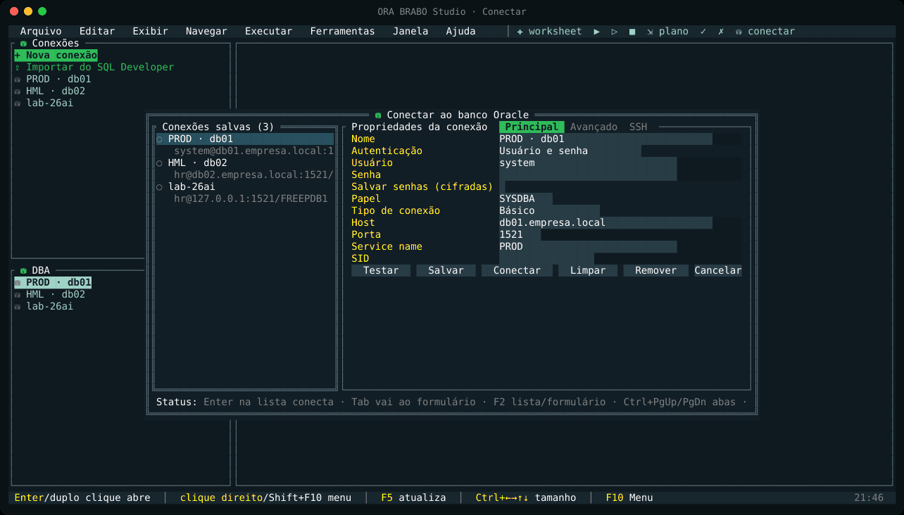

<sub>Conectar → worksheet → menus → clique direito → aba DBA → prévia da ação</sub>

</div>

---

## Português

- [Por que existe](#por-que-existe)
- [A interface](#a-interface)
- [Telas](#telas)
- [O que ele faz](#o-que-ele-faz)
- [Segurança primeiro](#segurança-primeiro)
- [Atalhos](#atalhos)
- [Instalar](#instalar)
- [Usar](#usar)
- [Como é feito](#como-é-feito)
- [Status](#status) · [Roadmap](#roadmap) · [Perguntas](#perguntas)

### Por que existe

O DBA passa o dia dentro de servidores: jump host, SSH, VPN de cliente, console de nuvem. Nesses lugares quase nunca dá para abrir uma IDE gráfica de 800 MB que pede Java e um desktop. Sobra o SQL*Plus, que não lista, não navega e não ajuda.

O **ORA BRABO Studio** leva para o terminal o que o DBA mais usa num estúdio gráfico:
- uma worksheet SQL decente;
- um navegador de objetos;
- uma **aba DBA** inteira, com instância, armazenamento, segurança, RMAN, Data Pump, AWR/ASH/ADDM, Resource Manager, Scheduler e monitoramento.

Tudo isso por teclado e mouse, dentro de uma sessão SSH comum.

| | Estúdio gráfico tradicional | **ORA BRABO Studio** |
|---|---|---|
| Instalação | ~850 MB + Java | **1 binário de 22 MB** |
| Cliente Oracle | JDBC / Instant Client | **nenhum** (driver Go puro) |
| Onde roda | desktop com interface gráfica | **qualquer terminal, inclusive por SSH** |
| Ações DBA | assistentes | assistente **com o comando à mostra, editável, antes de rodar** |
| Idioma | — | **PT-BR e EN** |

### A interface

O layout segue o de um estúdio gráfico Oracle, adaptado ao terminal:
- **barra de menus** (Arquivo, Editar, Exibir, Navegar, Executar, Ferramentas, Janela, Ajuda) e **barra de ferramentas** (✚ ▶ ▷ ■ ⇲ ✓ ✗ ⛁). F10 abre os menus, e o mouse funciona em tudo;
- à esquerda, o painel **Conexões** (com o navegador de objetos) e, embaixo, o painel **DBA**. Os dois ficam visíveis e mudam de tamanho com `Ctrl+setas`;
- à direita, as **abas**: worksheets, telas DBA e objetos;
- **clique direito** (ou `Shift+F10`) abre o menu de contexto em qualquer lugar: conexão, pasta, objeto, tela DBA, grade, texto e editor. Clique seleciona e **duplo clique abre**;
- na entrada aparece o diálogo **Conectar**: conexões salvas à esquerda e propriedades à direita, com Testar, Salvar e Conectar. `F9` reabre o diálogo;
- embaixo fica a **barra de status**, com os atalhos do lugar, a conexão da aba (usuário, contêiner, versão) e a hora. Clicar nela mostra o histórico de mensagens.

### Telas

| | |
|---|---|
| 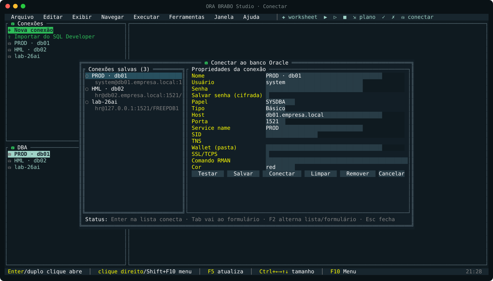<br>**Conectar**: abre na entrada, com as conexões salvas e as propriedades (Testar, Salvar, Conectar) | 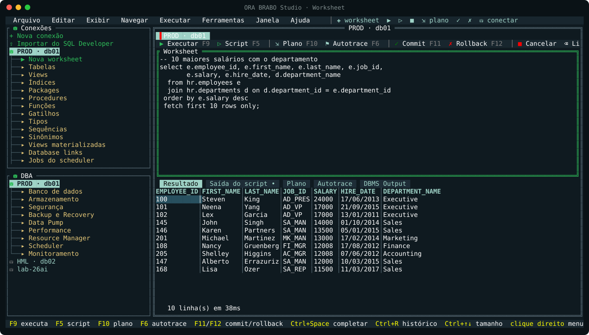<br>**Worksheet**: barra própria (▶ F9, ▷ F5, plano, autotrace, commit, rollback) e resultado em abas |
| 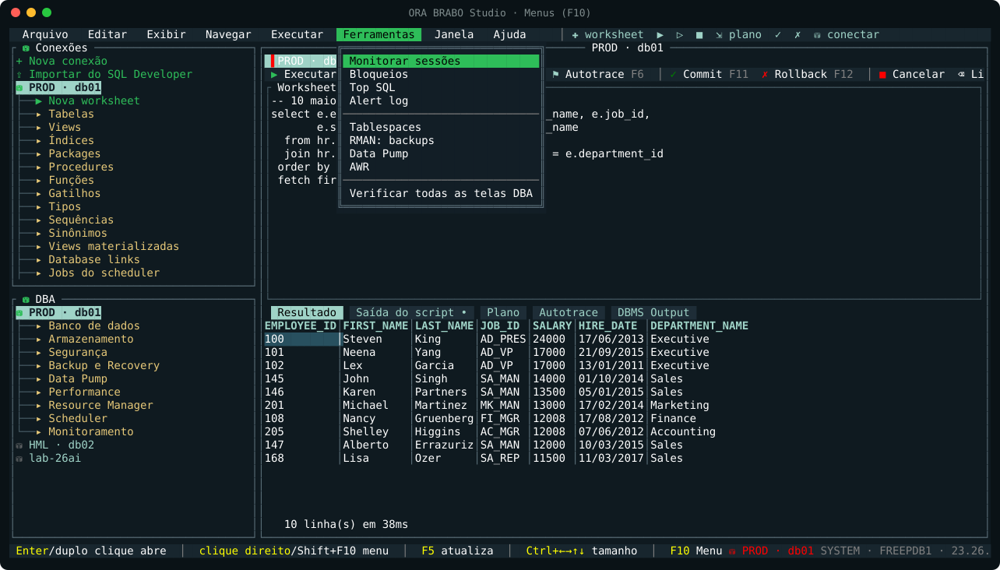<br>**Menus (F10)**: o menu Ferramentas abre as telas DBA mais usadas | 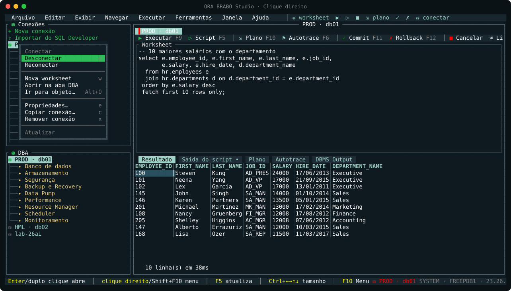<br>**Clique direito** numa conexão: conectar, worksheet, aba DBA, propriedades... |
| 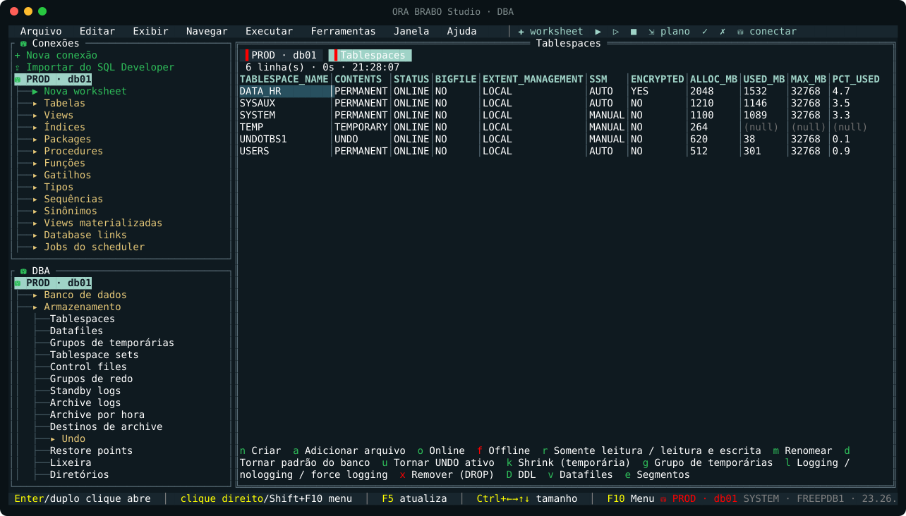<br>**Aba DBA**: painel embaixo das conexões; a tela de tablespaces lista as ações por letra | 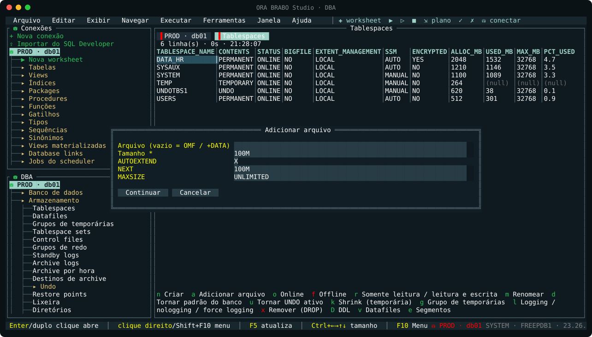<br>**Ação DBA**: formulário com os valores da linha selecionada já preenchidos |
| 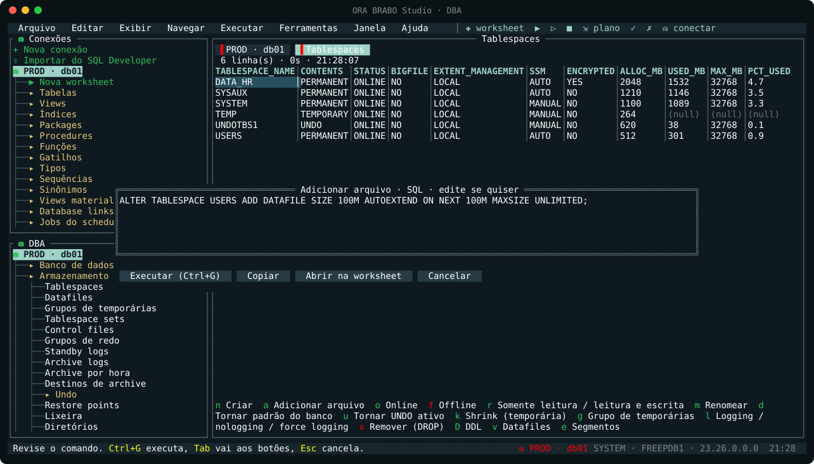<br>**Prévia**: o comando exato aparece antes de rodar e pode ser editado | 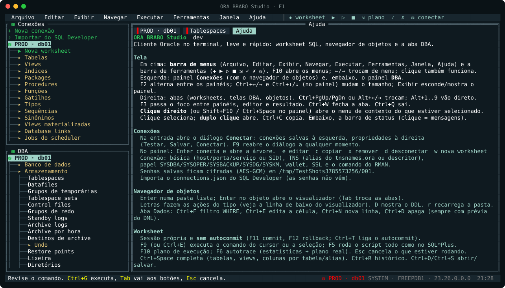<br>**F1**: ajuda completa dentro do programa |

> Os prints saem da tela real do programa (`internal/ui/shots_test.go`, em PT e EN). Os dados da worksheet e da tela de tablespaces são de exemplo. Os prints com um banco de verdade entram quando terminar a validação ao vivo (veja o [Status](#status)).

### O que ele faz

<details open>
<summary><b>Conexões</b></summary>

- Básica (host, porta, service name ou SID) ou **TNS**: alias lido do `tnsnames.ora` (`TNS_ADMIN`, `ORACLE_HOME`) ou descritor colado.
- Papéis **SYSDBA, SYSOPER, SYSBACKUP, SYSDG, SYSKM**; **wallet** (pasta) e **SSL/TCPS**.
- **Cor por conexão** (a aba de PROD em vermelho), que aparece nas abas e no topo.
- Senha opcionalmente salva, **cifrada com AES-GCM** e com chave local `0600`. Sem senha salva, ela é pedida a cada conexão.
- **Importa o `connections.json` do SQL Developer**. As senhas não vêm.
- **Comando RMAN** por conexão: `ssh oracle@db01 '. ~/.bash_profile; rman target /'`, `docker exec -i meu-oracle rman target /` ou local.

</details>

<details open>
<summary><b>Worksheet SQL</b></summary>

- Uma **sessão própria por aba**, **sem autocommit**. F11 faz commit, F12 rollback. O indicador PENDENTE aparece com DML aberto, e o programa avisa antes de fechar ou sair.
- **F9**: executa o comando do cursor (ou a seleção). **F5**: roda o script inteiro **como o SQL\*Plus** (`;`, `/` em linha sozinha, blocos PL/SQL, q-quotes, comentários).
- **F10**: plano (`EXPLAIN PLAN` + `DBMS_XPLAN`). **F6**: autotrace, com as estatísticas da sessão e o plano real (`ALLSTATS LAST`).
- **Variáveis `:bind`** pedidas num formulário (lembra os últimos valores).
- **DBMS_OUTPUT** automático. **Erros de compilação** com linha e coluna (`SHOW ERRORS`).
- Comandos do SQL\*Plus: `DESC`, `SET SERVEROUTPUT`, `SET AUTOCOMMIT`, `SHOW USER/ERRORS/PARAMETER/SGA/CON_NAME/PDBS`, `PROMPT`, `EXEC`.
- **Ctrl+Space** completa palavras-chave, tabelas e views, e **colunas por tabela ou alias** (`e.` → colunas de `emp e`).
- **Ctrl+R**: histórico por conexão. **Ctrl+O/Ctrl+S**: abrir e salvar `.sql`. **Esc** cancela o comando em execução.

</details>

<details open>
<summary><b>Grade de resultado</b></summary>

- Números alinhados à direita, `(null)` diferenciado, cabeçalho fixo.
- `Enter`/`v` mostra o valor completo da célula (CLOB, textos longos). `R` mostra o registro inteiro na vertical.
- `y` copia a célula e `Y` copia tudo (TAB, cola direto em planilha), pelo OSC 52, que funciona por SSH.
- `o` ordena pela coluna, `/` filtra e `x` exporta para **CSV, INSERT ou JSON**.

</details>

<details open>
<summary><b>Navegador de objetos</b></summary>

- Pastas: Tabelas, Views, Índices, Packages, Procedures, Funções, Gatilhos, Tipos, Sequências, Sinônimos, Views materializadas, Database links, Jobs, Filas (AQ) e Lixeira. Vale para o próprio usuário e para **Outros usuários**. Objetos inválidos aparecem em vermelho.
- O visualizador tem abas conforme o tipo. Para uma tabela: Colunas, **Dados**, Constraints, Índices, Estatísticas, Estatísticas de colunas, Gatilhos, Partições, Segmentos, Grants, Dependências, Detalhes e **DDL** (DBMS_METADATA, com índices e comentários).
- Ações do tipo por tecla:
  - tabela: coletar estatísticas, contar linhas, adicionar coluna, renomear, comentário, gatilhos e constraints ON/OFF, shrink, move online, lock, truncate, grant, sinônimo, drop;
  - índice: rebuild online, unusable, visível/invisível;
  - PL/SQL: compilar (com DEBUG);
  - MV: refresh;
  - sequência: alterar ou reiniciar;
  - DB link: testar;
  - job: executar, habilitar, desabilitar;
  - lixeira: restaurar ou purgar.
- **Aba Dados editável por ROWID**: Ctrl+E edita a célula, Ctrl+N cria uma linha, Ctrl+D apaga e Ctrl+F aplica um filtro WHERE. O DML sempre aparece antes de rodar.

</details>

<details open>
<summary><b>Aba DBA: 97 telas, centenas de ações</b> (lista completa em <a href="docs/CATALOGO.md">docs/CATALOGO.md</a>)</summary>

| Grupo | Telas |
|---|---|
| **Banco de dados** | Painel da instância (atualiza sozinho), **Top Activity** (gráfico por classe de espera, sem ASH), banco (ARCHIVELOG, flashback, force logging...), instância, parâmetros (ALTER SYSTEM / RESET / PFILE / SPFILE), serviços, **PDBs** (open, close, create, clone, refresh, unplug, plug, relocate, drop), registry, opções, uso de recursos |
| **Armazenamento** | Tablespaces (criar, add file, offline, read only, shrink...), datafiles (resize, autoextend, move online), grupos de temporárias, tablespace sets, control files, redo (grupos, membros, switch), standby logs, archive logs e **archive por hora**, destinos, undo, restore points, lixeira, diretórios, maiores segmentos |
| **Segurança** | Usuários (criar, senha, lock, expire, quota, grants, DDL), roles, profiles (14 limites), privilégios de sistema, de objeto e de role, **auditoria unificada** (políticas, trilha, purge) e tradicional |
| **Backup e recovery (RMAN)** | Configuração (SHOW ALL), FRA, jobs de backup (banco, tablespace, datafile, archivelogs, recovery area), backup sets e peças, cópias, crosscheck, delete obsolete, **restore e recover** (banco, tablespace, datafile, *until* SCN/tempo/sequência), block recovery, validate, preview, **RECOVER TABLE**, flashback database, LIST FAILURE |
| **Data Pump** | Jobs (export e import pelo DBMS_DATAPUMP: schema, tabela, full, remap, SQLFILE, paralelismo), parar, retomar, matar, limpar órfão, progresso |
| **Desempenho** | **AWR** (snapshots, relatórios texto/HTML, diff, SQL report, baselines, retenção), **ADDM**, **ASH** (eventos e SQL), **Statspack**, **SQL Monitor**, **SQL Tuning Advisor**, **SPM** (baselines, evolve), estatísticas do otimizador |
| **Resource Manager** | Plano ativo, planos, diretivas, consumer groups, mapeamentos, prioridades, planos de CDB |
| **Scheduler** | Jobs (executar, parar, habilitar), execuções, programas, schedules, janelas, chains, credenciais, DBMS_JOB, autotasks |
| **Monitoramento** | Sessões (kill, disconnect, cancelar SQL, plano, trace), **árvore de bloqueios**, objetos travados, **Top SQL** (plano, AWR, tuning, SPM), long ops, eventos de espera, métricas, tablespaces cheias, **alert log** (e só os erros), incidentes, inválidos (compilar / UTL_RECOMP), Data Guard |

Em toda tela:
- **F5** atualiza e **F4** liga a atualização automática.
- **Enter** mostra o registro.
- **?** abre a ajuda da tela, com a consulta usada.
- **letras** executam as ações, que ficam listadas no rodapé.
- **Ctrl+X** exporta.

</details>

### Segurança primeiro

1. **Nenhuma ação roda às cegas.** Toda ação gera o comando (SQL, PL/SQL ou RMAN) e o mostra numa prévia **editável**. Dela você pode **Executar** (Ctrl+G), **Copiar** ou **Abrir na worksheet**.
2. **Ações destrutivas** (drop, truncate, offline, kill, restore...) ficam em vermelho e só rodam depois que você **digita o nome do alvo**.
3. **Licenças.** AWR, ASH, ADDM, SQL Monitor e SQL Tuning exigem o *Diagnostics Pack* e o *Tuning Pack*. O programa pergunta antes de usar e mostra o `control_management_pack_access`. O Top Activity usa amostras do `V$SESSION` e **não depende do ASH**. O Statspack é a alternativa sem licença.
4. **Worksheet sem autocommit**, com aviso de pendência ao fechar a aba ou sair.
5. **Senhas** cifradas (AES-GCM) só quando você marca "salvar". Nada sai da sua máquina.

### Atalhos

| Onde | Tecla | Faz |
|---|---|---|
| Geral | `F1` | Ajuda |
| | `F10` | Menus (no editor da worksheet, F10 é o plano) |
| | clique direito, `Shift+F10` | Menu de contexto |
| | `F9` | Diálogo Conectar (fora da worksheet) |
| | `F2` | Alterna os painéis Conexões / DBA |
| | `F3` | Foco: painéis → editor → resultado |
| | `Ctrl+←/→`, `Ctrl+↑/↓` (no painel) | Largura do painel / divisão Conexões-DBA |
| | `Ctrl+C` | Copia o que estiver em foco |
| | `Ctrl+N` | Nova worksheet |
| | `Ctrl+W` / `Ctrl+Q` | Fecha a aba / sai |
| | `Ctrl+PgUp/PgDn`, `Alt+←/→`, `Alt+1..9` | Troca de aba |
| Worksheet | `F9` ou `Ctrl+E` | Executa o comando do cursor ou a seleção |
| | `F5` | Executa o script |
| | `F10` / `F6` | Plano / autotrace |
| | `F11` / `F12` | Commit / rollback |
| | `Ctrl+Space` | Completar |
| | `Ctrl+R` | Histórico |
| | `Ctrl+O` / `Ctrl+S` | Abrir / salvar |
| | `Ctrl+T` | Liga/desliga autocommit |
| | `Ctrl+↑/↓` | Altura do editor |
| | `Esc` | Cancela a execução |
| Árvore de conexões | `Enter` | Conecta / abre |
| | `e` `c` `x` `d` `w` | Editar, copiar, remover, desconectar, worksheet |
| Telas DBA | `F5` / `F4` | Atualiza / atualização automática |
| | `?` | Ajuda da tela |
| | letras | Ações |
| Grade | `Enter`/`v` `R` `y` `Y` `o` `/` `x` | Valor, registro, copia, copia tudo, ordena, filtra, exporta |

### Instalar

```bash
# com Go 1.24+
go install github.com/acaciolr/ora-brabo-studio/cmd/ora-brabo-studio@latest

# ou compile
git clone https://github.com/acaciolr/ora-brabo-studio && cd ora-brabo-studio
CGO_ENABLED=0 go build -trimpath -ldflags "-s -w" -o ora-brabo-studio ./cmd/ora-brabo-studio
```

O build é estático (sem CGO). O mesmo comando com `GOOS=windows` ou `GOOS=darwin` gera os binários de Windows e macOS.

### Usar

```bash
ora-brabo-studio                         # abre a interface
ora-brabo-studio --lang en               # em inglês (ou ORA_BRABO_LANG=en)
ora-brabo-studio check PROD -v           # sem interface: roda TODAS as consultas da aba DBA e aponta as que falham
ora-brabo-studio check -host db01 -port 1521 -service ORCLPDB1 -user system   # senha em ORA_BRABO_PASSWORD
```

O `check` serve para validar privilégios e versão antes de entregar a ferramenta a um time. Ele sai com código 1 se alguma tela falhar.

| Variável | Para quê |
|---|---|
| `ORA_BRABO_LANG=en` | Interface em inglês |
| `ORA_BRABO_STUDIO_HOME` | Pasta de configuração (padrão `~/.config/ora-brabo-studio`) |
| `ORA_BRABO_ASCII=1` | Troca o ícone ⛁ por `(=)` em terminais sem o glifo |
| `ORA_BRABO_PASSWORD` | Senha para o `check` |
| `TNS_ADMIN` | Onde procurar o `tnsnames.ora` |

**Privilégios:** a worksheet e o navegador funcionam com qualquer usuário. A aba DBA precisa de `SELECT_CATALOG_ROLE` para ler e de privilégios de DBA para as ações.

### Como é feito

```
cmd/ora-brabo-studio/     main, --lang, --version, check
internal/ora/             conexão (go-ora), sessão, divisor de script estilo SQL*Plus, explain, autotrace, DESC/SHOW
internal/catalog/         a aba DBA e o navegador como DADOS: View{SQL, Actions}, Action{Fields, Build → Script}
internal/ui/              tview/tcell: árvores, abas, worksheet, grade, executor de ações, painéis
internal/store/           conexões (AES-GCM), histórico, importação do SQL Developer
```

A aba DBA é **declarativa**: cada tela é uma consulta e uma lista de ações. Cada ação recebe a linha selecionada e os campos do formulário e devolve o script. Por isso dá para testar o catálogo inteiro sem banco: o `catalog_test.go` executa todas as ações com uma linha de exemplo e confere que o comando sai completo. Para incluir uma tela nova, basta acrescentar um `View` ao catálogo.

### Status

**Beta.** Situação de cada parte:
- **Testado:** o motor (divisor de script, TNS, armazenamento) e o catálogo (todas as ações geram comando válido).
- **Testado em tela simulada:** a interface, com diálogo Conectar, menus, prévia e confirmação destrutiva.
- **Em andamento:** a validação ao vivo contra Oracle 19c e 26ai, com a worksheet completa e o `check` nas 97 telas.

Bugs e sugestões são bem-vindos nas *issues*.

### Roadmap

- [ ] Validação ao vivo em 19c / 21c / 23ai / 26ai (single, CDB/PDB, RAC, Data Guard)
- [ ] Prints com dados reais; binários prontos nas *Releases*
- [ ] Realce de sintaxe na worksheet
- [ ] Comparação de esquemas e gerador de DDL em lote
- [ ] **MY BRABO Studio** (MySQL) e **PG BRABO Studio** (PostgreSQL), da mesma família

### Perguntas

**Precisa do Oracle Client?** Não. O driver é o go-ora, que fala o protocolo do Oracle direto.

**Funciona com Autonomous / wallet?** Sim: informe a pasta do wallet e use TCPS.

**E o RMAN, se o banco é remoto?** O RMAN roda onde o banco está. Configure o *Comando RMAN* da conexão (via `ssh` ou `docker exec`) e o programa envia o script pela entrada padrão, mostrando a saída ao vivo.

**Posso usar em produção?** Toda ação passa por prévia e as destrutivas pedem confirmação digitada. Mesmo assim, o projeto ainda está em beta: valide antes em homologação.

---

## English

**The DBA's Oracle studio, in the terminal.** SQL worksheet, object browser and a **DBA tab with 97 screens**, in a single 22 MB binary. No Java, no Instant Client: it uses the pure-Go [go-ora](https://github.com/sijms/go-ora) driver and runs in any terminal, including over SSH.

### Why

DBAs live inside servers: jump hosts, SSH, customer VPNs, cloud consoles. A graphical IDE that needs Java and a desktop rarely fits there, so SQL\*Plus is what's left. **ORA BRABO Studio** brings the essentials of a graphical studio to the terminal:
- a proper worksheet;
- an object browser;
- a full **DBA tab**: instance, storage, security, RMAN, Data Pump, AWR/ASH/ADDM, Resource Manager, Scheduler and monitoring.

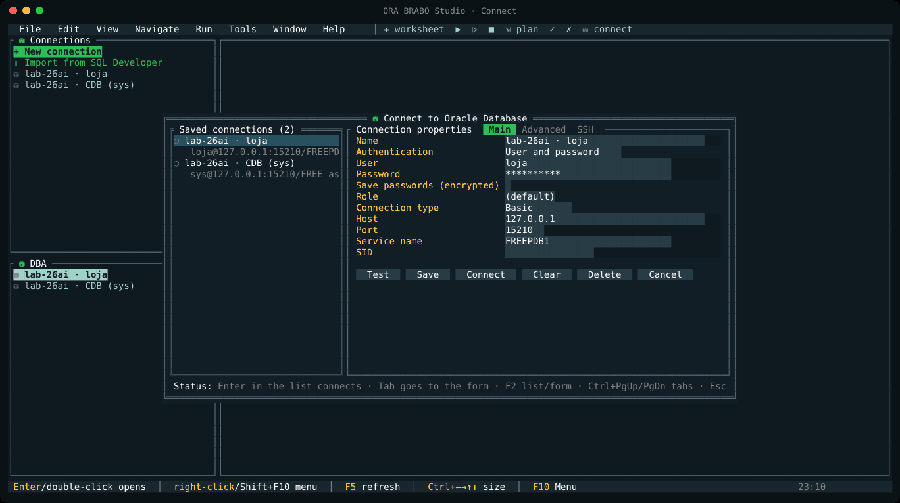

### The interface

The layout follows a graphical Oracle studio, adapted to the terminal:
- a **menu bar** (File, Edit, View, Navigate, Run, Tools, Window, Help) and a **toolbar** (✚ ▶ ▷ ■ ⇲ ✓ ✗ ⛁). F10 opens the menus, and the mouse works everywhere;
- on the left, the **Connections** pane (with the object browser) and, below it, the **DBA** pane. Both stay visible and resize with `Ctrl+arrows`;
- on the right, the **tabs**: worksheets, DBA screens and objects;
- **right click** (or `Shift+F10`) opens a context menu everywhere: connection, folder, object, DBA screen, grid, text and editor. A click selects and a **double click opens**;
- at startup the **Connect** dialog opens: saved connections on the left, properties on the right, with Test, Save and Connect. `F9` reopens it;
- at the bottom, the **status bar** shows the shortcuts for where you are, the tab's connection (user, container, version) and the time. Clicking it shows the message history.

### Screens

| | |
|---|---|
| <br>**Connect**: opens at startup with the saved connections and their properties (Test, Save, Connect) | 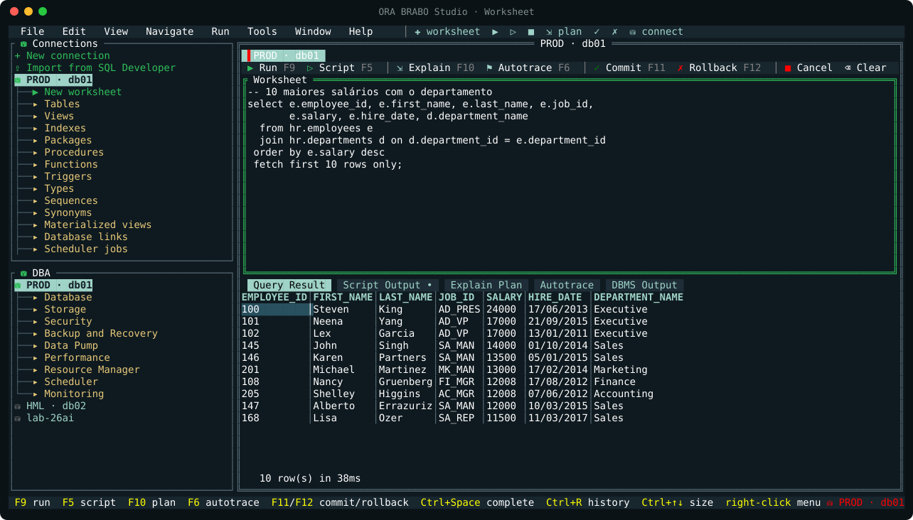<br>**Worksheet**: its own toolbar (▶ F9, ▷ F5, plan, autotrace, commit, rollback) and tabbed results |
| 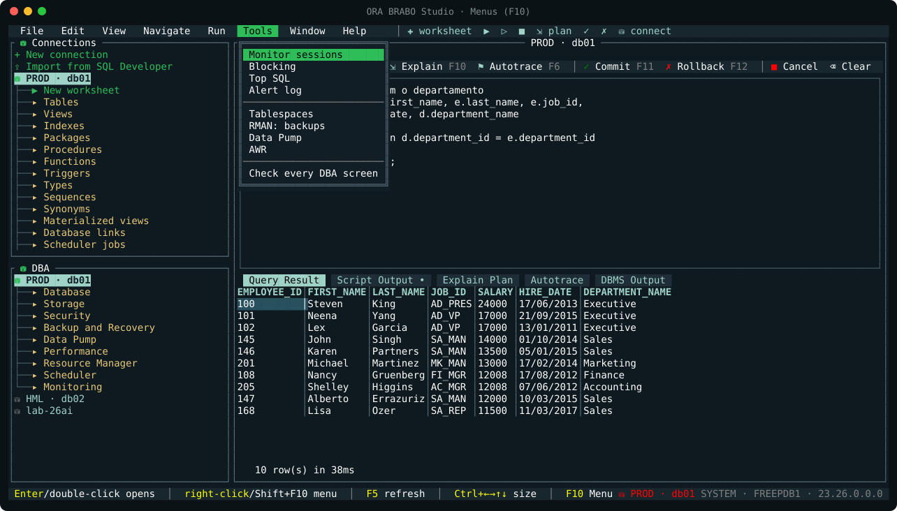<br>**Menus (F10)**: the Tools menu opens the most used DBA screens | 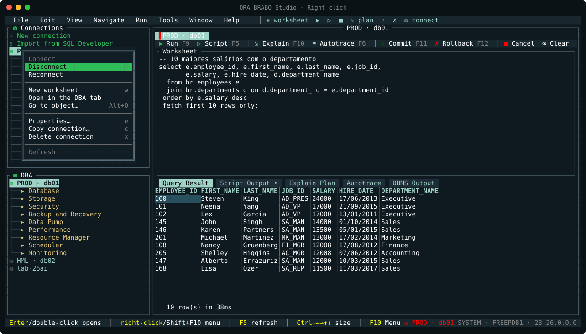<br>**Right click** on a connection: connect, worksheet, DBA tab, properties... |
| 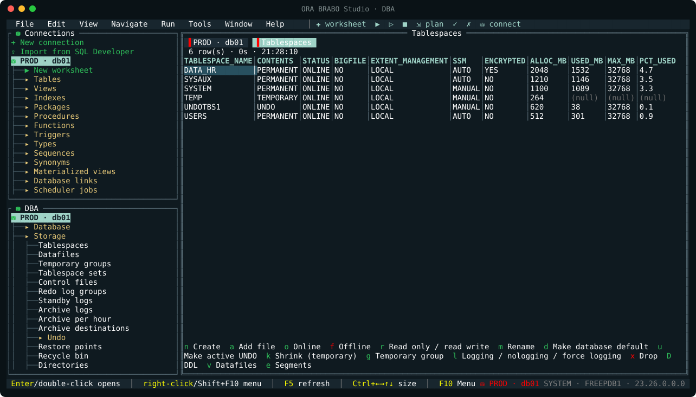<br>**DBA tab**: pane below the connections; the tablespaces screen lists its actions by letter | 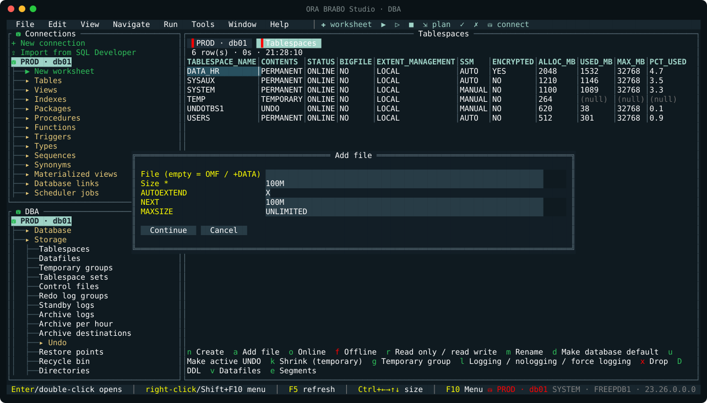<br>**DBA action**: form pre-filled from the selected row |
| 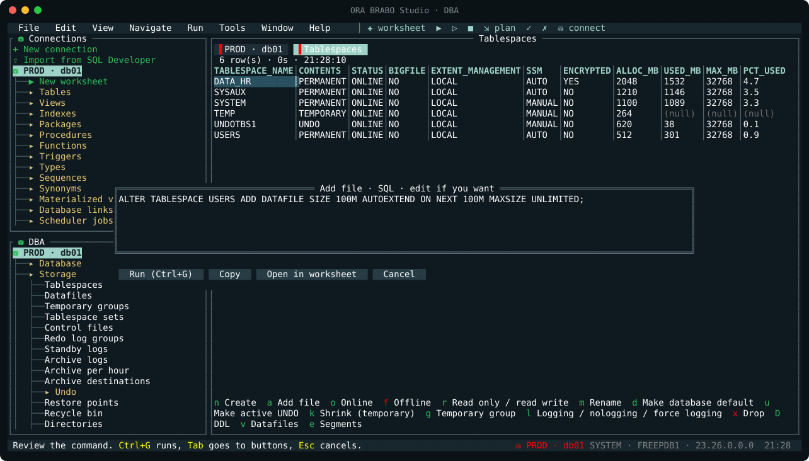<br>**Preview**: the exact command is shown, editable, before it runs | 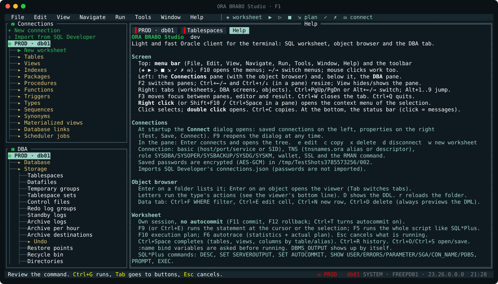<br>**F1**: full in-app help |

> Screenshots come from the program's real screen (`internal/ui/shots_test.go`, PT and EN). The worksheet and tablespace data are samples; screenshots against a real database come after live validation.

### Features

- **Connections**
  - Connection types: basic, TNS alias or descriptor.
  - Roles: SYSDBA, SYSOPER, SYSBACKUP, SYSDG, SYSKM.
  - Wallet, SSL/TCPS and a color per connection.
  - Passwords can be saved, encrypted with AES-GCM.
  - Imports SQL Developer connections.
  - Per-connection RMAN command (ssh / docker exec / local).
- **Worksheet**
  - One session per tab, **no autocommit** (F11/F12), with a pending-changes warning.
  - F9 runs the statement, F5 runs the script SQL\*Plus style, F10 shows the plan, F6 runs autotrace.
  - Binds, DBMS_OUTPUT, compile errors.
  - DESC/SET/SHOW/PROMPT/EXEC.
  - Completion including columns by alias, history, open/save, cancel.
- **Result grid**
  - Cell viewer and record view.
  - Copy over SSH (OSC 52), sort, filter.
  - Export to CSV / INSERT / JSON.
- **Object browser**
  - 15 object types, for your own user and for other users.
  - The viewer has tabs per type (columns, data, constraints, indexes, stats, partitions, segments, grants, dependencies, code, errors, DDL).
  - Actions per type.
  - Data tab editable by ROWID.
- **DBA tab**: 97 screens in 9 groups. The full list is in [docs/CATALOG.md](docs/CATALOG.md).

### Safety first

1. Every action shows the generated command in an **editable preview** before it runs.
2. Destructive actions require **typing the target name**.
3. Pack-licensed features (AWR, ASH, ADDM, SQL Monitor, SQL Tuning) ask first. Top Activity samples `V$SESSION` (no ASH); Statspack is the license-free alternative.
4. The worksheet has no autocommit and warns about pending transactions.
5. Passwords are saved only on request, encrypted locally.

### Install and use

```bash
go install github.com/acaciolr/ora-brabo-studio/cmd/ora-brabo-studio@latest
ora-brabo-studio --lang en
ora-brabo-studio check PROD -v      # headless: runs every DBA tab query, reports failures (exit 1)
```

Configuration lives in `~/.config/ora-brabo-studio` (`ORA_BRABO_STUDIO_HOME`). Use `ORA_BRABO_ASCII=1` for terminals without the ⛁ glyph.

**Privileges:** the worksheet and browser work with any user. The DBA tab needs `SELECT_CATALOG_ROLE` to read and DBA privileges to act.

### Status

**Beta.**
- **Tested:** the engine and the catalog.
- **Tested on a simulated screen:** the UI.
- **In progress:** live validation against 19c and 26ai.

The roadmap includes syntax highlighting, schema compare, release binaries, and the sibling tools **MY BRABO Studio** (MySQL) and **PG BRABO Studio** (PostgreSQL).

---

<div align="center">

Oracle e SQL Developer são marcas da Oracle Corporation. Este projeto é independente e não tem vínculo com a Oracle.<br>
*Oracle and SQL Developer are trademarks of Oracle Corporation. This project is independent and not affiliated with Oracle.*

**MIT** · **by • DBA BRABO**

</div>
